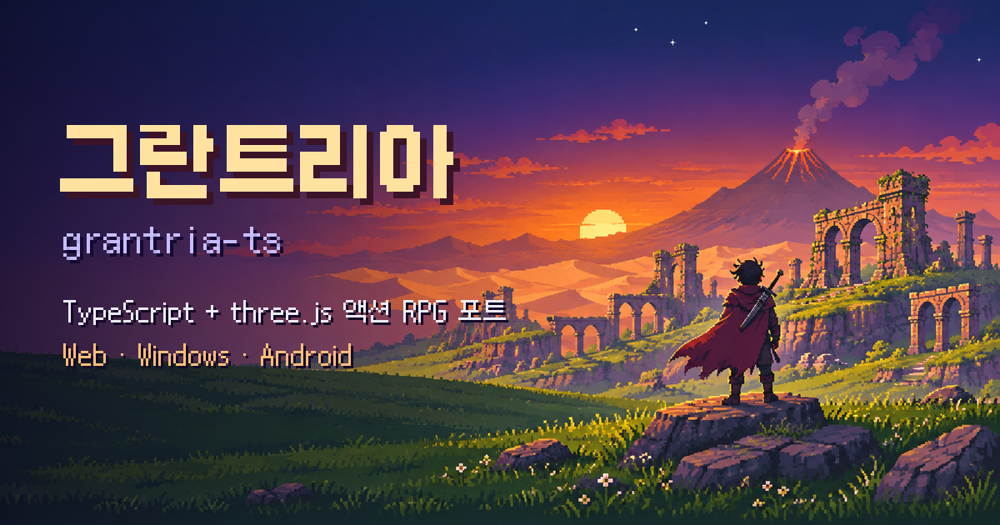
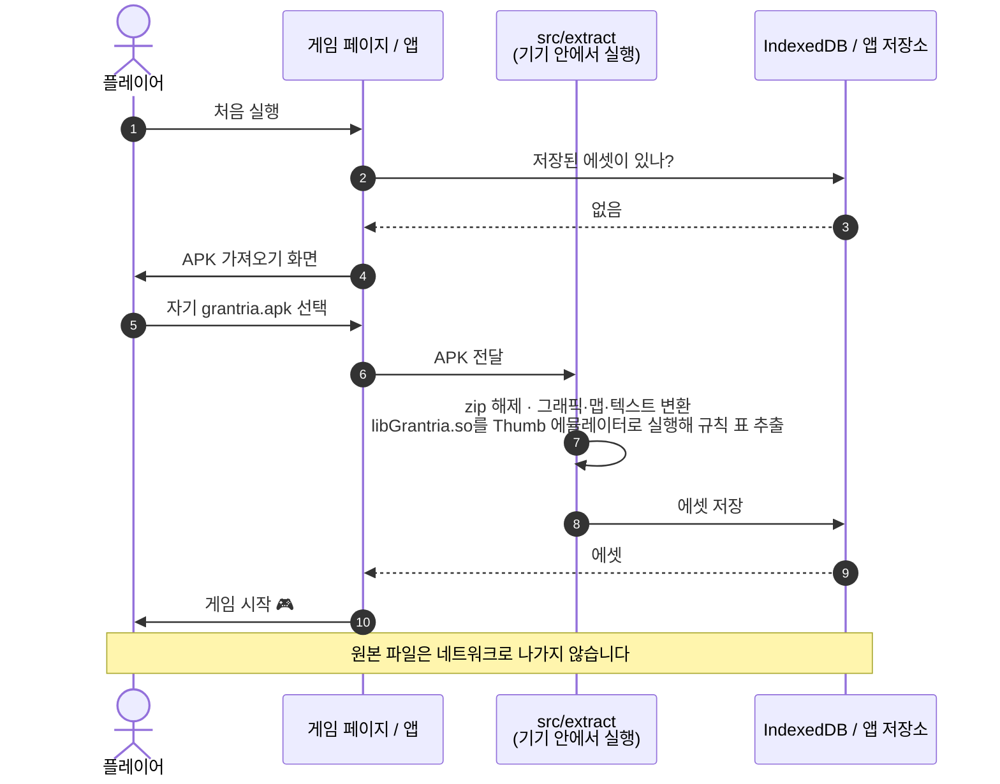
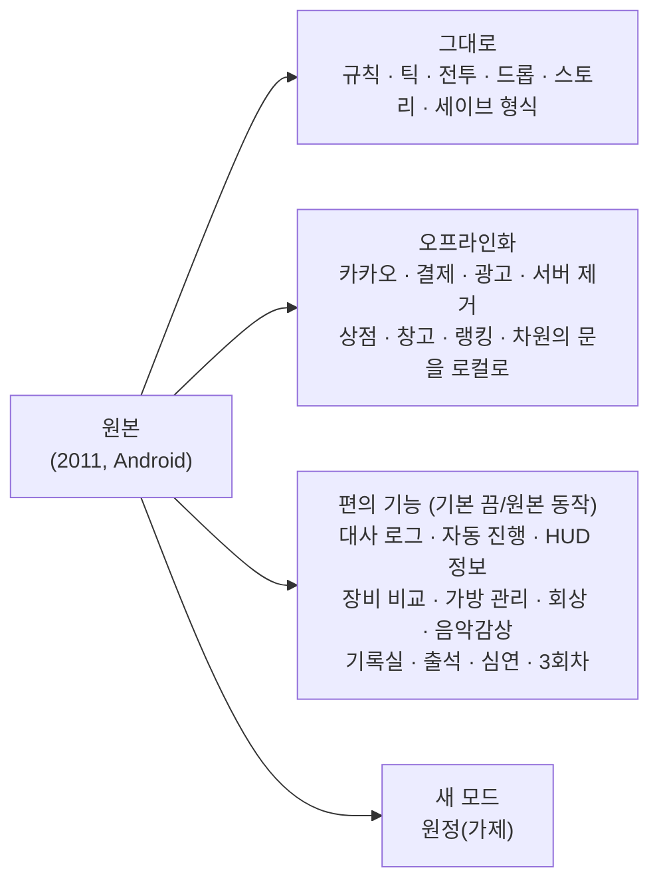
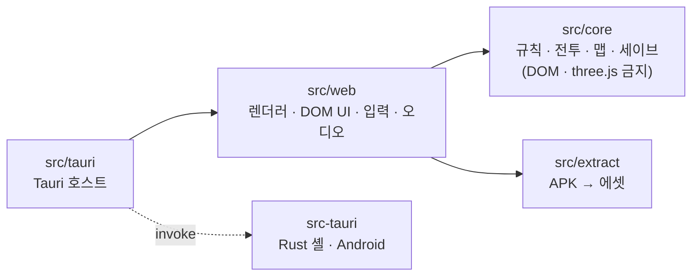

<p align="center">
  
</p>

<h1 align="center">grantria-ts</h1>

<p align="center">
  Enerve의 2011년 안드로이드 액션 RPG <b>그란트리아(Grantria)</b>를<br>
  리버스 엔지니어링 분석을 바탕으로 <b>TypeScript + three.js</b>로 옮긴 포트
</p>

<p align="center">
  <a href="https://ring-wdr.github.io/grantria-ts/game.html"><b>▶ 브라우저에서 플레이</b></a> ·
  <a href="docs/development.md">개발 가이드</a> ·
  <a href="docs/README.md">문서</a> ·
  <a href="docs/release-notes.md">릴리즈 노트</a>
</p>

<p align="center">
  <a href="https://github.com/Ring-wdr/grantria-ts/actions/workflows/pages.yml"></a>
  
  
  
  
  
</p>

> [!IMPORTANT]
> **이 저장소에는 원본 게임 파일이 없습니다.** APK, 네이티브 라이브러리, 디컴파일 결과, 이미지·사운드·맵·텍스트 같은 게임 에셋, 원본에서 추출한 데이터 표는 커밋하지도, 배포하지도 않습니다.
> 플레이하려면 **직접 가진 `grantria.apk`** 가 필요합니다. 처음 실행할 때 APK를 고르면 그 기기 안에서 에셋을 만들고, 외부로는 아무것도 보내지 않습니다.

## 목차

- [특징](#특징)
- [플레이하기](#플레이하기)
- [어떻게 동작하나](#어떻게-동작하나)
- [조작 요약](#조작-요약)
- [원본과 다른 점](#원본과-다른-점)
- [개발](#개발)
- [프로젝트 구조](#프로젝트-구조)
- [문서](#문서)

## 특징

- 🎯 **원본 규칙 그대로** — 20 FPS 고정 틱, 480×320 화면, 전투·몬스터 AI·이벤트 스크립트·퀘스트·상점·보스·하드 모드·어둠의 정원·차원의 문을 원본 규칙대로 재현합니다.
- 🌐 **어디서나** — 브라우저(설치형 PWA), Windows 데스크톱, Android 앱이 같은 코드로 돕니다.
- 🎮 **모든 입력** — 키보드, PS·Xbox 게임패드, 터치(위치·크기를 바꿀 수 있는 가상 스틱).
- 📴 **완전 오프라인** — 로그인·결제·광고·서버 없이, 서버가 하던 일은 로컬에서 원본 흐름대로 처리합니다.
- ✨ **켜고 끌 수 있는 편의 기능** — 대사 로그, 자동 진행, 장비 비교, 일괄 판매, 회상, 음악감상… 기본값은 모두 원본 동작입니다.
- 💾 **원본 세이브 호환** — 원본 `save.dat`를 가져오고 원본 형식으로 내보낼 수 있습니다.
- 🗡️ **새 모드: 원정(가제)** — 필드 액션과 턴제 전투를 섞은 로그라이크 프로토타입.

## 플레이하기

| 플랫폼 | 방법 | 에셋 |
|---|---|---|
| 🌐 **웹** | [ring-wdr.github.io/grantria-ts](https://ring-wdr.github.io/grantria-ts/game.html)를 엽니다. 휴대폰은 홈 화면에 추가하면 전체 화면 앱으로 열립니다 | 첫 실행 때 APK 선택 → IndexedDB에 저장 |
| 🪟 **Windows** | `npm run tauri:build`로 설치 파일(msi, setup.exe)을 만듭니다 | 첫 실행 때 APK 선택 → 앱 데이터에 저장 |
| 🤖 **Android** | `npm run tauri:android:build`로 APK를 만듭니다 | 첫 실행 때 APK 선택 |
| 🛠️ **로컬 개발** | `npm run dev` → <http://localhost:5173/game.html> | APK 선택, 또는 `npm run assets`로 미리 생성 |

자세한 빌드 방법은 [개발 가이드](docs/development.md)에 있습니다.

## 어떻게 동작하나



공개 웹 빌드는 게임 코드와 추출 로직만 담습니다. 빌드와 배포 워크플로가 게임 데이터가 섞였는지 두 번 검사하고, 섞이면 실패합니다.

## 조작 요약

| 동작 | ⌨️ 키보드 | 🎮 패드 (PS / Xbox) |
|---|---|---|
| 이동 | 방향키 / `WASD` | 왼쪽 스틱 |
| 공격 · 대화 · 확인 | `Z` `Enter` `Space` | ✕ / A |
| 메뉴 · 취소 | `Esc` | ○ / B · Start |
| 퀵슬롯 | `1` `2` `3` `4` | □ △ L1 R1 / X Y LB RB |
| 지도 · 저장 · 퀘스트 | `M` · `P` · `J` | CREATE / VIEW · R3 · D패드 ↑ |
| 대사 로그 · 자동 진행 | `L` · `K` | D패드 → · 대사 중 △ / Y |
| 풀스크린 | `F11` · `Alt+Enter` | |

터치 배치, 화면별 버튼, 키 설정은 **[조작 문서](docs/controls.md)** 에 있습니다.

## 원본과 다른 점



전체 목록은 **[원본과 다른 점](docs/differences.md)**, 원정 모드는 **[원정 문서](docs/expedition.md)** 에 있습니다.

## 개발

```bash
npm ci
```

```bash
npm run dev
```

APK에서 에셋을 미리 만들려면 [apktool](https://apktool.org/)과 Python 3.10+가 필요합니다.

```bash
apktool d grantria.apk -o apk
```

```bash
npm run assets
```

| 명령 | 내용 |
|---|---|
| `npm run dev` | 개발 서버 (`game.html` 게임, `index.html` 맵 뷰어) |
| `npm run build` | 타입 검사 + 정적 빌드 |
| `npm run build:pages` | 공개 웹 빌드 (게임 데이터가 섞이면 실패) |
| `npm test` | 단위 테스트 (`node --test`) |
| `npm run tauri:dev` · `tauri:build` | 데스크톱 앱 실행 · 설치 파일 |
| `npm run tauri:android:build` | Android APK |

요구 사항, 전체 스크립트, 도구, 배포 흐름은 **[개발 가이드](docs/development.md)** 에 있습니다.

## 프로젝트 구조



의존은 `tauri → web → core` 한 방향뿐이고, `tests/boundary.test.ts`와 DOM 타입 없는 `tsconfig.core.json`이 이를 검사합니다.

| 경로 | 내용 |
|---|---|
| [`src/core/`](src/core) | 플랫폼 무관 게임 로직 (규칙, 전투, 맵·통행, 이벤트, 메뉴, 세이브) |
| [`src/web/`](src/web) | 브라우저 실행 환경: 부트스트랩, WebGL 렌더러, DOM UI, 입력, 오디오, 화면 |
| [`src/extract/`](src/extract) | APK → 웹 에셋 변환 (페이지 · 웹뷰 · node 테스트에서 공용) |
| [`src/tauri/`](src/tauri) | Tauri 호스트 플랫폼 |
| [`src-tauri/`](src-tauri) | Tauri 2 셸 (Rust), Android 프로젝트 (`gen/android`) |
| [`tests/`](tests) | `node --test` 단위 테스트 |
| [`tools/`](tools) | Python 에셋 변환 · 규칙 표 추출 · 성능 측정 |
| [`pwa/`](pwa) | 공개 웹 빌드의 매니페스트 · 아이콘 · 서비스 워커 · 미리보기 이미지 |
| [`docs/`](docs) | 문서 |

자세한 구조는 [architecture.md](docs/architecture.md)를 보세요.

## 문서

| 플레이어 | 개발자 |
|---|---|
| [조작](docs/controls.md) | [개발 가이드](docs/development.md) |
| [원본과 다른 점](docs/differences.md) | [소스 구조](docs/architecture.md) |
| [원정 (가제)](docs/expedition.md) | [트러블슈팅 기록](docs/troubleshooting.md) |
| [릴리즈 노트](docs/release-notes.md) | [장시간 성능 측정](docs/perf-soak.md) |

설계 검토 문서까지 포함한 전체 목록은 [docs/README.md](docs/README.md)에 있습니다.

---

<sub>그란트리아(Grantria)와 원작의 모든 에셋에 대한 권리는 원저작자에게 있습니다. 이 프로젝트는 비공식 팬 포트이며 원저작자와 관계가 없습니다. 상단 이미지는 이 저장소를 위해 새로 만든 그림으로, 원작 에셋을 쓰지 않았습니다. 글꼴은 <a href="https://github.com/quiple/galmuri">Galmuri</a>(OFL)를 씁니다.</sub>
