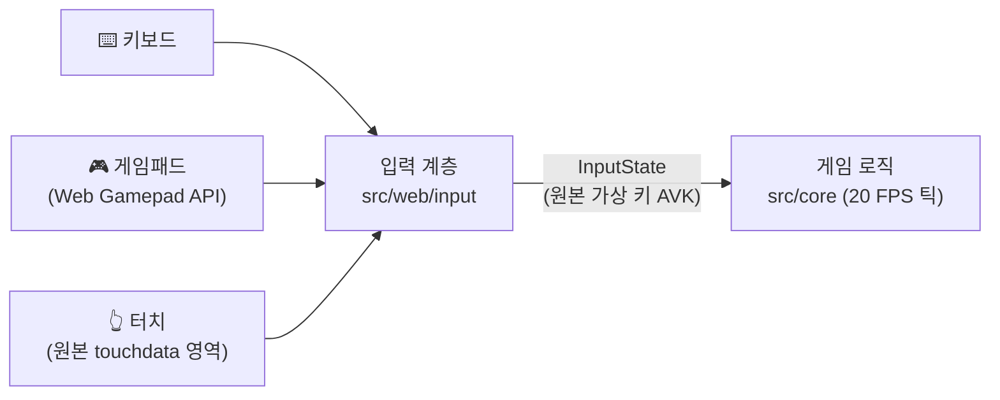

# 조작

[← README](../README.md) · [문서 목록](README.md)

키보드·게임패드·터치 세 가지 입력을 모두 지원합니다. 원본은 휴대폰 키패드(`0`~`9`, `*`, `#`)로 조작했기 때문에, 아래 표의 작은따옴표(`'5'`, `'#'` …)는 **원본 키패드의 어떤 키에 해당하는지**를 뜻합니다.

- [키보드](#키보드)
- [게임패드](#게임패드)
- [터치](#터치)
- [키 설정과 버튼 표시](#키-설정과-버튼-표시)
- [화면 채우기 (풀스크린)](#화면-채우기-풀스크린)

## 키보드

| 키 | 원본 키 | 동작 |
|---|---|---|
| 방향키 / `W` `A` `S` `D` | 방향 | 이동 |
| `Z` · `Enter` · `Space` | `'5'` | 공격 · 대화 · 확인 |
| `X` | `'#'` | |
| `C` | `'*'` | |
| `1` `2` `3` `4` | `'1'` `'3'` `'7'` `'9'` | 퀵슬롯 |
| `Esc` | | 메뉴 / 취소 (바꿀 수 없음) |
| `M` | | 지도 |
| `P` | | 저장 |
| `J` | | 퀘스트 |
| `B` | | 고급상점 |
| `G` | | 차원의 문 |
| `Q` / `E` | | 메뉴 이전 / 다음 탭 |
| `L` | | 대사 로그 |
| `K` | | 자동 진행 켬/끔 |
| 확인 키 또는 왼쪽 `Ctrl` 길게 (0.3초+) | | 대사 빨리 넘기기 |
| `F11` · `Alt+Enter` | | 풀스크린 켬/끔 |

키보드·패드로 메뉴의 원형 탭을 고르면 원본처럼 고른 탭이 맨 위로 오도록 링이 돕니다. 터치에서는 링이 고정되고 선택 표시만 움직입니다.

## 게임패드

PS·Xbox 패드를 [Web Gamepad API](https://developer.mozilla.org/docs/Web/API/Gamepad_API)로 읽습니다.

| PlayStation | Xbox | 원본 키 / 동작 |
|---|---|---|
| ✕ (아래) | A | 확인 |
| ○ (오른쪽) · Start | B · Start | 메뉴 / 취소 |
| □ (왼쪽) | X | `'1'` |
| △ (위) | Y | `'3'` |
| L1 | LB | `'7'` · 메뉴에서 이전 탭 |
| R1 | RB | `'9'` · 메뉴에서 다음 탭 |
| L2 | LT | `'*'` |
| R2 | RT | `'#'` |
| CREATE · 터치패드 | VIEW | 지도 |
| R3 | R3 | 저장 |
| 왼쪽 스틱 | 왼쪽 스틱 | 아날로그 이동 (터치 가상 스틱과 같음) |
| 오른쪽 스틱 ↕ | 오른쪽 스틱 ↕ | 스킬 설명·도움말 같은 긴 글 스크롤 |

### 필드에서 D패드

필드에서는 D패드가 이동 대신 HUD 버튼을 누릅니다.

| D패드 | 동작 |
|---|---|
| ↑ | QUEST |
| ← | SHOP |
| → | 대사 로그 |
| ↓ | 차원의 문 아이콘 (커뮤니티) |

### 원본 키패드 `'0'`을 대신하는 버튼

원본의 `'0'` 기능은 화면마다 다른 버튼이 맡습니다.

| 화면 | 버튼 |
|---|---|
| 캐릭터 칭호 | ↑ |
| 퀵슬롯 해제 | → |
| 아이템 보석 장착 | L2 |
| 랭킹 | △ / Y |
| 가방정리 (인벤토리·상점 판매/강화) | R2 (`'#'`) — 인벤토리에서는 가방 관리 메뉴를 엽니다 |
| 타이틀의 옵션 · 도움말 · 데이터 | □ · △ · L2 |

### 그 밖의 화면

- **퀵슬롯 등록·해제 창**: ↑↓로 고르거나 슬롯 버튼(□ / △ / L1 / R1 / L2 / R2)을 바로 누릅니다.
- **창고 골드전송**: 키보드는 숫자 키 또는 화면 숫자 버튼, 패드는 방향키로 금액을 조절(↑↓ ±1, ←→ ±10, 천 골드 단위)한 뒤 확인으로 보냅니다.
- **대사 중**: □(키보드 `1`) = 대사 로그, △(키보드 `2`) = 자동 진행.

> [!NOTE]
> 표준 매핑이 아닌 DualShock 4 / DualSense / Xbox(xpad)는 vendor/product 표로 맞춥니다. WebKitGTK처럼 Gamepad API가 없는 환경에서는 패드가 동작하지 않습니다.

## 터치

터치(포인터)는 원본의 touchdata 영역과 화면 버튼을 그대로 씁니다.

휴대폰 가로 화면의 배치:

| 왼쪽 여백 | 가운데 | 오른쪽 여백 |
|:---:|:---:|:---:|
| 🕹️ 가상 스틱 | 게임 화면 480×320 | ☰ 메뉴 · 퀵슬롯 · ⚔️ 공격 |
| ◀ ▶ (예/아니오) | 원본 touchdata 영역 | SKIP · ✔ 확인 |

- **넓은 화면 배치**: 화면이 3:2보다 넓은 터치 기기(휴대폰 가로)에서는 가상 스틱을 왼쪽 끝으로, 메뉴·퀵슬롯·공격 버튼과 이벤트 SKIP을 오른쪽 끝 여백으로 옮깁니다.
- **대사·이벤트·팝업 중**: 오른쪽 끝에 확인 버튼(패드의 확인과 같음), 왼쪽 끝에 예/아니오를 바꾸는 ◀ ▶가 남습니다.
- **가상 스틱**은 터치로 조작할 때만 보입니다.
- **조작 배치 편집** (편의 설정 → 조작 배치)
  - 스틱과 공격·퀵슬롯·메뉴·대사 로그 버튼을 끌어서 옮깁니다.
  - 두 손가락(마우스 휠)이나 툴바로 크기(60~180%)를, 전체 투명도를 바꿉니다.
  - 각 버튼은 가까운 화면 끝을 기준으로 저장되므로(`grantria.touchLayout`) 화면 비율이 달라도 그 끝에 붙어 있습니다.

## 키 설정과 버튼 표시

- 키보드 키와 패드 버튼은 **환경설정 → 키 설정**에서 바꿉니다. 슬롯과 무관한 전역 설정이고, `Esc`는 취소로 고정입니다.
- 키보드·마우스로 플레이하면 HUD 버튼에 해당 키가, 패드를 쓰면 패드 종류에 맞는 버튼 기호가 표시됩니다. 대사창의 LOG·AUTO 버튼도 쓰는 입력 장치에 맞춰 `L`/`K` 또는 □/△로 바뀝니다.

## 화면 채우기 (풀스크린)

| 환경 | 기본값 | 동작 |
|---|---|---|
| 터치 기기 | 켬 (직접 바꾸면 그 설정을 따름) | 화면 높이에 맞춰 키우고 좌우 여백까지 필드를 그립니다 |
| 데스크톱 | 끔 | 켜면 Tauri 창(브라우저는 페이지)을 전체 화면으로 바꾸고 터치와 같은 방식으로 화면을 채웁니다. 게임 밖에서 전체 화면을 풀면 설정도 꺼집니다 |

- 로고·타이틀(슬롯·캐릭터 선택·회상·랭킹·데이터 화면의 배경 포함)도 여백까지 그리고, 메뉴·팝업은 가운데 480×320 그대로입니다.
- 시작 로고와 등급 안내 화면은 원본 에셋처럼 흰 바탕이라 화면 바깥도 흰색으로 둡니다.
- 휴대폰 브라우저에서는 첫 탭부터 브라우저 전체 화면 + 가로 고정을 요청하고, 세로로 들면 "화면을 가로로 돌려 주세요" 안내가 뜹니다. 홈 화면에 설치한 앱(PWA)은 처음부터 전체 화면으로 열립니다.

## 기기별 참고

- **진동**: 원본처럼 500 ms 진동(설정 변경, 스킬 적중, 강한 타격, 피격)을 휴대폰(브라우저는 `navigator.vibrate`, Android 앱은 시스템 진동)과 진동 모터가 있는 게임패드에 보냅니다. WebView2가 진동시키지 못하는 DualSense는 Windows 데스크톱 앱이 HID로 직접 진동시킵니다.
- **소리**: 앱(Tauri 데스크톱·Android)에서는 첫 화면부터, 브라우저는 정책상 첫 입력 뒤부터 납니다. 창을 최소화하거나 앱이 백그라운드로 가면 꺼집니다.
- **Android 뒤로가기**: 로고·타이틀에서는 종료 확인, 그 밖에서는 메뉴/취소입니다. 패드 B(○)는 게임 안의 취소 키라 타이틀에서는 아무 동작도 하지 않습니다.
