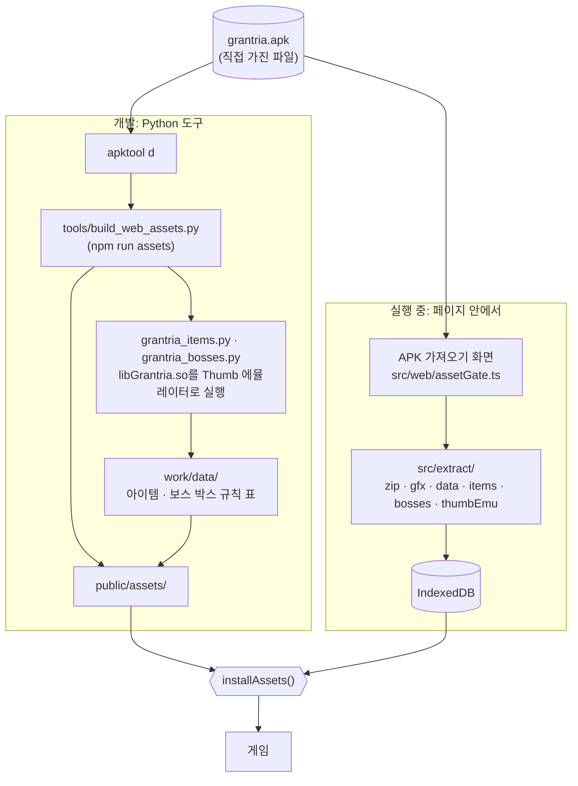
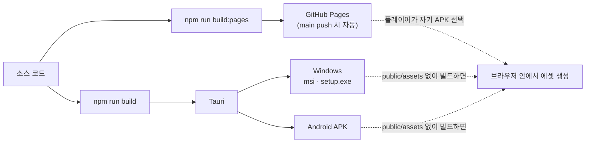

# 개발 가이드

[← README](../README.md) · [문서 목록](README.md)

- [요구 사항](#요구-사항)
- [로컬에서 실행하기](#로컬에서-실행하기)
- [에셋은 어떻게 만들어지나](#에셋은-어떻게-만들어지나)
- [npm 스크립트](#npm-스크립트)
- [도구 스크립트](#도구-스크립트)
- [빌드와 배포](#빌드와-배포)
- [테스트](#테스트)

## 요구 사항

| 도구 | 버전 | 용도 |
|---|---|---|
| Node.js | 22 이상 | 개발 서버·빌드. 테스트는 Node의 TypeScript 타입 제거 실행을 씁니다 |
| Python | 3.10 이상 | 에셋·데이터 변환 도구 (표준 라이브러리만 사용) |
| [apktool](https://apktool.org/) | | APK 디코드 |
| Rust stable (rustup) | | *선택* — 데스크톱·Android 앱 빌드 |
| MSVC 빌드 도구 · WebView2 | | *선택* — Windows 데스크톱 앱 |
| Android SDK · NDK (`NDK_HOME`) · JDK 17+ | | *선택* — Android 앱. Rust 타깃 `aarch64-linux-android` 등, Windows는 개발자 모드(심볼릭 링크) |

## 로컬에서 실행하기

```bash
npm ci
```

```bash
apktool d grantria.apk -o apk
```

```bash
npm run assets
```

```bash
npm run dev
```

1. `apktool`이 `apk/assets`, `apk/lib/armeabi/libGrantria.so`, `apk/res/raw`를 만듭니다.
2. `npm run assets`가 `apk/`에서 `public/assets`(이미지 · cmf · 맵 · 텍스트 · `d.dat` · 규칙 표 · 사운드)를 만듭니다.
3. <http://localhost:5173/game.html>에서 게임을, <http://localhost:5173/>에서 맵 뷰어를 엽니다.

> [!TIP]
> `public/assets` 없이 `npm run dev`만 띄워도 됩니다. 게임 페이지가 APK 가져오기 화면을 띄우고 브라우저 안에서 에셋을 만듭니다. 저장된 에셋을 두고 APK를 다시 고르려면 `game.html#apk`로 엽니다.

- `npm run assets -- <APK의 assets 폴더> [출력 폴더]`로 경로를 바꿀 수 있습니다.
- `npm run ref`는 맵 뷰어(`index.html`)의 픽셀 비교용 참조 이미지를 만듭니다.

> [!WARNING]
> `apk/`, `public/assets`, `work/`, `tests/fixtures/`는 원본에서 나온 파일이라 커밋하지 않습니다(`.gitignore`).

## 에셋은 어떻게 만들어지나

같은 변환을 두 곳에서 할 수 있습니다. 결과는 같습니다.



부팅 때 `installAssets`(`src/web/assetGate.ts`)가 데이터를 고릅니다.

1. 페이지 옆에 `assets/`가 있으면(= `public/assets`로 만든 개인 빌드) 그것을 씁니다.
2. 없으면 IndexedDB에 저장된 추출본을 씁니다.
3. 그것도 없으면 APK 가져오기 화면을 띄웁니다. 추출은 기기 안에서만 하고 외부로 보내지 않습니다.

## npm 스크립트

| 명령 | 내용 |
|---|---|
| `npm run dev` | 개발 서버 (`game.html` 게임, `index.html` 맵 뷰어) |
| `npm run build` | 타입 검사 + 정적 빌드 (`dist/`) |
| `npm run build:pages` | 공개 웹 빌드 (`dist/`). 게임 페이지만, `public/` 대신 `pwa/`, 게임 데이터가 섞이면 실패 |
| `npm run typecheck` | `tsc` 두 번: 전체, 그리고 DOM 타입 없는 `src/core` (`tsconfig.core.json`) |
| `npm test` | 단위 테스트 |
| `npm run assets` | APK → `public/assets` |
| `npm run ref` | 맵 뷰어 비교용 참조 이미지 |
| `npm run fixtures` | 상점 공식 · 스킬 상세 테스트용 픽스처를 원본 코드 실행으로 생성 (`tests/fixtures/`, 커밋하지 않음) |
| `npm run tauri:dev` | Tauri 데스크톱 앱 실행 |
| `npm run tauri:build` | Windows 설치 파일 (msi, setup.exe) |
| `npm run tauri:android:dev` | 연결된 기기에 설치 후 개발 서버에 붙음 |
| `npm run tauri:android:build` | Android APK. `-- --debug`는 디버그 키 서명, 릴리스는 `src-tauri/gen/android/app/keystore.properties`가 있으면 서명 |

## 도구 스크립트

```bash
python -I tools/grantria_origverify.py DIR MEMBER
```

데이터 관리 화면에서 내보낸 원본 세이브(`save.dat` / `gamedata.dat` / `option.dat`)를 원본 라이브러리의 암·복호화·체크섬 함수로 대조합니다.

```bash
python -I tools/perf_soak.py --serial IP:PORT
```

장시간 플레이 중 폰의 온도 · 전력 · CPU · 메모리를 (무선) adb로 CSV에 기록하고 빌드끼리 비교합니다. → [perf-soak.md](perf-soak.md)

## 빌드와 배포



### 웹 (GitHub Pages)

[`.github/workflows/pages.yml`](../.github/workflows/pages.yml)이 `main`에 push될 때 `npm run build:pages`로 빌드해 배포합니다.

- 게임 코드와 APK 추출 로직만 올립니다. 원본 파일과 추출한 에셋은 올리지 않습니다.
- 빌드(`vite.config.ts`의 `GAME_DATA`)와 워크플로가 두 번 검사해 게임 데이터가 섞이면 실패합니다.
- 결과물은 설치형 앱(PWA)입니다: `pwa/`의 매니페스트(전체 화면 · 가로), 아이콘, 네트워크 우선 서비스 워커, iPhone 홈 화면 태그, 소셜 미리보기(`og-image.png`).
- 사용자 도메인에 올릴 때는 `VITE_BASE=/`로 경로를, `VITE_SITE_URL`로 미리보기 이미지의 절대 주소를 바꿉니다.

### 데스크톱 · Android (Tauri)

같은 코드를 Tauri 2로 묶습니다. 구조와 빌드 세부는 [architecture.md](architecture.md), 프레임워크 선택은 [desktop-electron-vs-tauri.md](desktop-electron-vs-tauri.md)를 보세요.

> [!CAUTION]
> `public/assets`가 있는 상태로 앱을 빌드하면 결과물에 직접 만든 게임 에셋이 들어갑니다. **개인용으로만 쓰세요.** `public/assets` 없이 빌드한 앱은 웹 버전처럼 첫 실행 때 APK를 고릅니다.

버전별 변경 사항은 [release-notes.md](release-notes.md)에 있습니다.

## 테스트

```bash
npm test
```

`node --test`로 `tests/**/*.test.ts`를 돌립니다(규칙 공식, 원본 세이브 XTEA·변환, 경로 탐색, 원정 밸런스 등). 에셋이나 픽스처가 필요한 테스트는 없으면 건너뜁니다.

`tests/boundary.test.ts`는 코드 규칙도 검사합니다.

- 계층 의존 방향 `tauri → web → core`
- `web`에서 `platform().name` 비교 금지
- 셸이 부를 `window` 전역, Kotlin의 `evaluateJavascript` · `addJavascriptInterface` 금지
- 원정 모드가 본편 코드를 가져오지 않음

## 소스 주석 표기

소스 주석의 `analysis/features/*.md`, `FUN_xxxxxxxx` 표기는 이 포트를 만들 때 쓴 분석 노트(이 저장소에 없음)와 원본 함수 주소를 가리킵니다.
