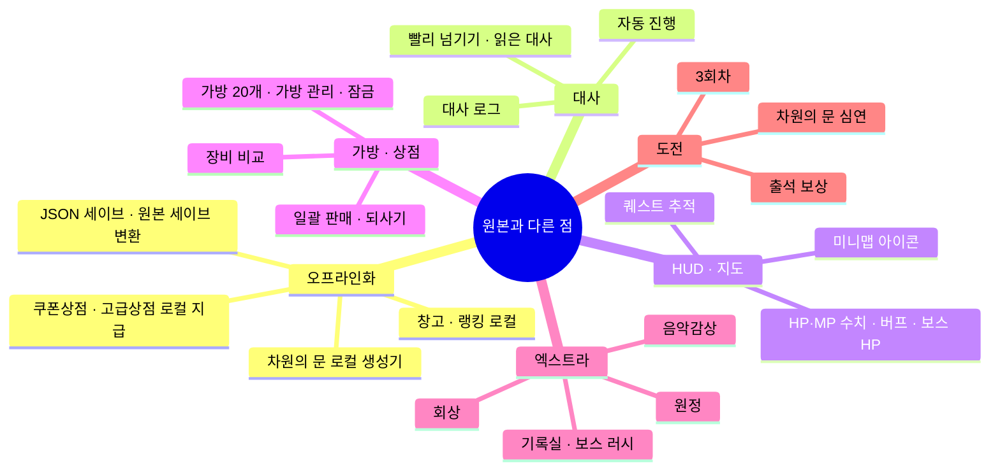
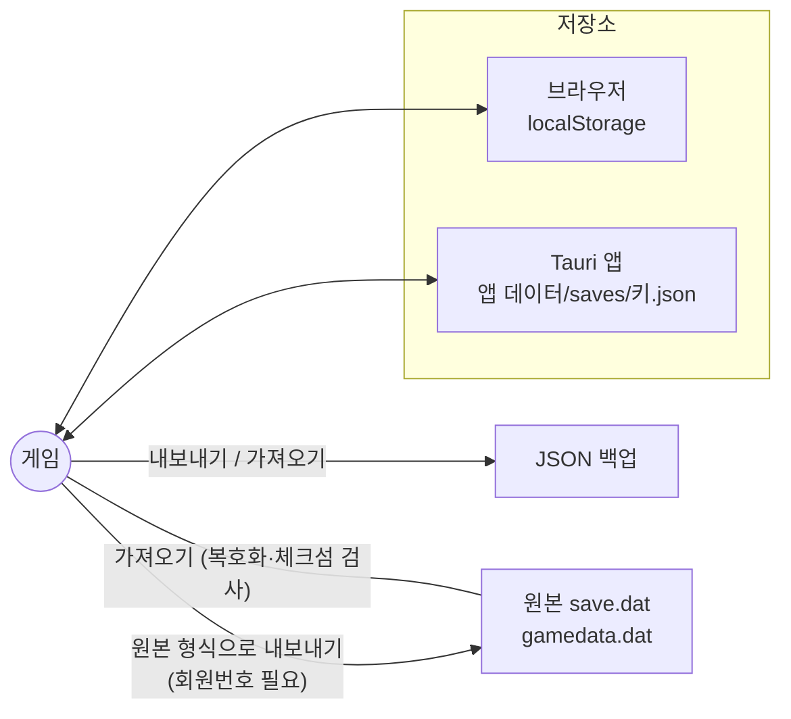
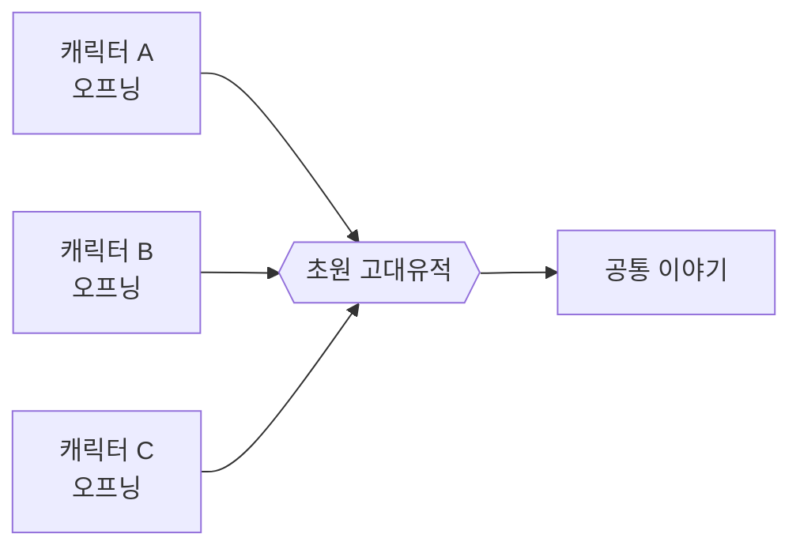

# 원본과 다른 점

[← README](../README.md) · [문서 목록](README.md)

이 포트는 원본 규칙(20 FPS 틱, 전투·수치·드롭·스토리 진행)을 그대로 재현하는 것을 목표로 합니다. 달라진 점은 두 갈래입니다.

1. [**오프라인화**](#오프라인화) — 서버·결제·광고가 맡던 기능을 로컬에서 대신합니다.
2. [**편의 기능**](#편의-기능) — 원본에 없던 기능입니다. **기본값은 모두 원본 동작**이고, 게임 메뉴 → 환경설정 → 편의 설정에서 켜고 끕니다. 설계 기준은 [ux-modernization.md](ux-modernization.md)에 있습니다.

그 밖에 원본에 없는 모드로 [원정(가제)](expedition.md)이 있습니다.



## 오프라인화

| 원본 (서버 기능) | 이 포트 |
|---|---|
| 카카오 로그인 · 결제 · 광고 | 없음 |
| 쿠폰상점 | 무료 로컬 지급 |
| 고급상점 | 클라이언트에 남아 있던 기본 목록을 쿠폰으로 판매 |
| 창고 | 슬롯 공용 로컬 저장소 |
| 게임순위 | 로컬 랭킹 |
| 차원의 문 (서버가 층 데이터를 내려줌) | 같은 클라이언트 규칙을 쓰는 로컬 생성기 |
| 서버가 처리하던 쿠폰 구매 | 로컬에서 원본 흐름대로 처리 |

- 도구 없이 강화·분해·제작서 사용을 고르면 도구를 쿠폰으로 사고 이어서 진행합니다(팝업 `0x49`; 강화석 10개 = 10장, 마법 해체기·대장장이의 모루 = 15장).
- 고급상점에 특성·스탯·스킬 포인트 상품(가격은 임의로 29 / 19 / 19장)이, 창고에 골드전송(슬롯 공용 창고에 천 골드 단위로 맡김)이 있습니다.
- 가방이 가득 찬 날의 운세 보상은 잃지 않고 보관했다가 빈 칸이 생기면 지급합니다.

### 세이브



- 세이브는 JSON으로 저장합니다. 브라우저는 localStorage, Tauri 앱은 앱 데이터 폴더의 `saves/` 안에 항목마다 파일 하나씩 둡니다(이전 빌드의 `grantria.json`은 처음 실행할 때 옮깁니다).
- 타이틀의 info 아이콘(데이터 관리)에서 JSON 백업을 내보내고 가져오거나, 원본 `save.dat` / `gamedata.dat`를 가져오고 원본 형식으로 내보낼 수 있습니다.
- 슬롯 세이브 형식은 편의 기능 때문에 바뀌지 않습니다. 편의 설정은 `option.dat` 밖에 저장하므로 원본 옵션 내보내기도 그대로입니다.

## 편의 기능

### 대사

| 기능 | 여는 방법 | 설명 |
|---|---|---|
| **대사 로그** | `L` · 필드에서 D패드 → · 대사 중 □(키보드 `1`) · 대사창 LOG 버튼 · 필드 오른쪽 대사 로그 버튼 | 이벤트 대사, NPC 대화, 자막을 모아 봅니다. 필드의 버튼은 원본 쿠폰상점 버튼 자리이고, 쿠폰상점은 차원의 문 아이콘(커뮤니티) 메뉴로 옮겼습니다 |
| **자동 진행** | `K` (필드 어디서나) · 대사 중 △(키보드 `2`) · AUTO 버튼 | 대사가 없을 때 `K`를 누르면 켬/끔을 화면에 알립니다. 대사가 떠 있는 동안 이벤트 시계는 멈춰 있으므로 연출 타이밍은 원본과 같습니다 |
| **빨리 넘기기** | 확인 키나 왼쪽 `Ctrl`을 0.3초 넘게 누름 | 기본은 읽은 대사만 넘깁니다. 대사가 열리기 전부터 누르고 있던 키는 한 번 떼야 동작합니다 |
| **읽은 대사** | — | 슬롯 공용으로 기록하고(`grantria.read`) 대사창에 "읽은 대사"로 표시합니다 |
| **페이지 끝 표시** | — | 대사 페이지가 끝나면 ▼를 표시합니다 |

### HUD · 지도

- **HUD 정보** (표시만): 왼쪽 아래 HP·MP 수치와 EXP %(기본 끔), 비약 버프 아이콘과 남은 시간, 가까운 보스의 HP 바, 진행 중인 퀘스트 3개와 처치·수집 진행도(퀘스트 상세의 '추적 켬/끔'으로 퀘스트마다 뺄 수 있음).
- **지도**: 미니맵에 퀘스트 NPC와 공간이동석 아이콘, 지도에 진행 중인 모든 퀘스트의 목적지, 퀘스트 상세에 처치·수집 진행도와 (도감에 있으면) 서식지.

### 가방 · 장비 · 상점

- **장비 비교**: 가방에서 장비를 고르면 이름 옆에 착용 장비 대비 주 능력치 증감(▲▼)을, 아이템 상세에 주 능력치·옵션·소켓의 차이를 보여 줍니다.
- **장착 아이템 버리기 확인**: 장비 탭에서 장착한 아이템을 버릴 때 확인 팝업을 띄웁니다(원본은 바로 지웁니다).
- **상점**
  - 수량 팝업에 -10 / +10 / 최대 (L1 / R1 / L2, 키보드 `3` / `4` / `C`).
  - 판매하는 상점에 **일괄 판매**(강화하지 않고 보석이 없는 장비를 등급별로)와 **되사기**(이번 방문에서 판 아이템 20개까지, 판 값에).
- **가방**
  - 쿠폰으로 사는 가방이 17개까지 늘었습니다(가방 20개, 320칸). 가방 줄은 스크롤됩니다.
  - 슬롯은 아이템 목록 하나와 산 가방 수만 저장하므로 형식은 그대로입니다. 원본 세이브로 내보낼 때는 원본 한도(가방 2개, 80칸)까지만 넣고 넘는 아이템 수를 알려 줍니다.
  - 인벤토리의 가방정리(`'#'`)는 **가방 관리** 메뉴를 엽니다.

    | 메뉴 | 대상 |
    |---|---|
    | 정렬 | 가방 전체 |
    | 일괄 버리기 | 일괄 판매와 같은 장비 (유료·퀘스트 아이템, 재료 제외) |
    | 조합서 버리기 | 조합서를 등급별로 |
    | 일괄 분해 | 일괄 판매와 같은 장비. 마법 해체기 필요(없으면 쿠폰 구매 팝업 `0x49`) |

  - 재료 묶음이 9999개에 닿아 멈추면 가방 부족 대신 그 재료를 알려 줍니다. 칸은 장비 칸이 비고 새 재료만 칸을 차지하는 것으로 셉니다.
  - 장비는 가방의 행동 메뉴에서 **잠글** 수 있고, 잠긴 장비는 분해·버리기·판매와 일괄 처리에서 빠집니다.
  - 가방에서 귀환서를 쓰면 메뉴가 모두 닫힙니다.

### 저장

- 슬롯 카드 왼쪽 위에 회차(1·2·3회차) 표시.
- 맵 이동 자동 저장(기본 끔).

### 타이틀 메뉴 · 엑스트라

타이틀 메뉴는 원본의 버튼 줄 대신 **게임시작 · 엑스트라(회상 · 음악감상 · 원정) · 환경설정 · 도움말 · 게임순위**를 화면 왼쪽에 세로로 두고, 다른 화면에서 돌아오면 마지막으로 고른 줄을 유지합니다.

#### 회상

이야기 전체를 순서도로 보여 줍니다. 세 캐릭터의 오프닝 이야기가 초원 고대유적에서 합쳐져 공통 길로 이어집니다(`src/core/data/storyChart.ts`).



- 본 장면과, 그 캐릭터의 길에서 그보다 앞선 장면을 다시 봅니다. 공통 장면은 고른 시점(캐릭터, `1`/`3` 키)으로 봅니다.
- 「이어서 보기」(`C` / 패드 L2)를 켜면 장면이 끝날 때 다음 장면이 이어지고 `Esc`로 멈춥니다.
- 회상 장면에서도 LOG·AUTO를 쓰며, 로그는 그 장면 것만 담습니다.
- 슬롯과 무관하게 계정 공용으로 기록합니다(`grantria.records`의 `seen`; 이 기능 전에 만든 슬롯의 진행은 처음 열 때 한 번 옮김). 슬롯 없이 그 기록만으로 장면을 만들며, 스크립트가 끝나면 필드 없이 목록으로 돌아옵니다.
- 회상 횟수는 SKIP·`Esc` 없이 끝까지 본 회상만 셉니다.

#### 음악감상

배경음 19곡 중 들어 본 곡을 다시 듣습니다(`src/web/game/musicRoom.ts`).

| 조작 | 키보드 / 패드 |
|---|---|
| 일시정지 | `1` / □ |
| 이전 · 다음 곡 (들어 본 곡만) | `Q` · `E` / L1 · R1 |
| 셔플 | `2` / △ |
| 계속 재생 (한 곡이 끝나면 다음 곡) | `C` / L2 |

- 배경음이 재생될 때마다 계정 공용으로 기록하고(`grantria.records`의 `heard`), 이 기능 전의 진행은 세이브의 방문 지역·본 이벤트·보스 처치·사망 기록으로 채웁니다.
- 곡 이름은 이 포트가 붙인 것입니다.

#### 원정 (가제)

본편과 따로 도는 로그라이크 프로토타입입니다. → [expedition.md](expedition.md)

### 기록실

게임 메뉴 → 환경설정 탭의 넷째 줄(원본의 몬스터도감 자리)에 있습니다.

| 항목 | 내용 |
|---|---|
| 몬스터 도감 | 원본 |
| 아이템 도감 | 얻은 아이템 |
| 보스 기록 | 처치 수 · 최단 시간 · 무피격 |
| 보스 러시 | 기록된 보스를 연달아 (슬롯 사본에서 진행) |
| 도전과제 | 원본 50개와 추가 11개 (보상은 골드만, 계정당 한 번) |
| 출석 · 심연 기록 | |

아이템 도감·보스 기록·보스 러시·심연 기록은 슬롯 공용(`grantria.records`)입니다.

### 도전 요소

- **출석 보상**: 하루 첫 필드 진입 때(운세 다음) 7일 주기 보상을 줍니다. 아이템은 운세 표에서 고르고, 7일째에는 황금알을 더합니다. 황금알은 이 포트에서 사용할 수 있습니다(골드 + 대길 상품). 운영자 상자(`0x33`~`0x38`)는 내용을 알 수 없어 여전히 얻을 수 없습니다.
- **차원의 문 심연** (편의 설정에서 켬, 기본 끔): 보스를 잡은 뒤 같은 던전을 더 강한 층으로 다시 내려갈 수 있습니다.

  ```mermaid
  flowchart LR
    BOSS["보스 처치"] --> Q{"더 내려갈까?"}
    Q -- "아니오" --> OUT["결과 받고 나가기<br/>(원본과 같음)"]
    Q -- "예" --> DEEP["다음 단계<br/>몬스터 HP·공격 +25~30%<br/>경험치 +10%<br/>주간 규칙: 광폭 / 강철 / 물량"]
    DEEP --> BOSS
  ```

  내려가기 전 클리어의 보상은 지켜지고, 더 깊은 단계는 그 단계를 클리어해야 보상이 더해집니다.

- **3회차**: 하드 모드 엔딩을 보면 슬롯 선택 화면에서 `*`로 3회차를 시작할 수 있습니다(하드 모드와 같은 방식으로 전환, 몬스터 HP ×1.5 · 공격 ×1.25, 경험치 ×1.5, 회차 값 4). 랭킹 점수식에 원래 있던 3회차 보너스(+300)가 이제 쓰입니다.

### 편의 설정 목록

환경설정 → 편의 설정에 있는 항목입니다.

- 배경음·효과음 볼륨(0~10), 텍스트 속도
- 자동 진행과 그 속도, 빨리 넘기기
- 화면 흔들림 · 번쩍임 줄이기
- HUD 정보 · 미니맵 아이콘 · 퀘스트 위치 · 맵 이동 자동 저장 · 심연 도전 각각의 켬/끔
- 퀵슬롯 쿨다운 숫자
- SKIP 이어 넘기기 (기본 끔: 퀘스트 팝업을 닫으면 이벤트 끝까지 다시 넘김)
- 산 오토루팅 끄기
- 터치 조작 배치 (위치 · 크기 · 투명도) — [조작](controls.md#터치)
- 절전 모드 (다시 시작하면 적용) — [architecture.md](architecture.md#그리기와-절전-모드)
- 기본값으로 되돌리기

### 개발자 모드

편의 설정의 「버프 표시」를 연속 10번 바꾸면 환경설정에 생깁니다. 슬롯 밖(`grantria.dev`)에 저장합니다.

| 항목 | 범위 | 설명 |
|---|---|---|
| 사냥 경험치 배율 | ×1~10 | ×N = N마리 처치로 계산해 도감·퀘스트·업적 수와 맞춤 |
| 드랍 배율 | ×1~10 | 드랍 판정을 N번 |
| 영웅·전설 확률 | ×1~10 | 드랍 등급 판정에서 그 구간만 N배로 넓힘 |
| 성능 기록 | 기본 끔 | 1분마다 틱·그리기 시간과 프레임 간격의 p50/p95/최대, 롱태스크, JS 힙, three.js 리소스를 기록하고 JSON으로 내보냄 ([perf-soak.md](perf-soak.md)) |
