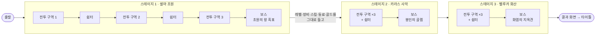
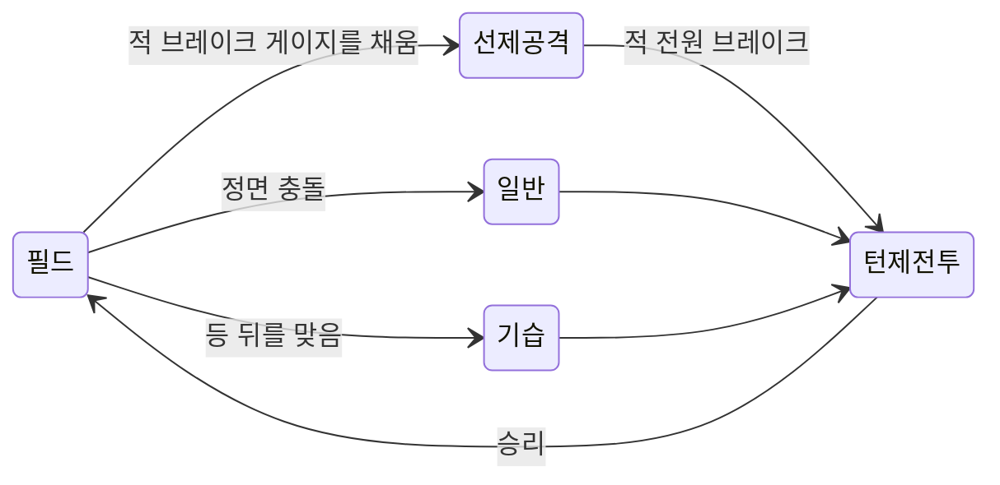

# 원정 (가제)

[← README](../README.md) · [문서 목록](README.md)

> [!NOTE]
> 프로토타입입니다. 타이틀 메뉴 **엑스트라 → 원정**에서 시작합니다. 수치와 설계 근거는 [expedition-balance.md](expedition-balance.md)에 있습니다.

본편과 따로 도는 로그라이크 모드입니다(`src/core/expedition`, `src/web/expedition`).

- 세이브 슬롯을 쓰지 않고 런은 메모리에만 있습니다. 앱을 끄면 사라지고, 본편 세이브에는 영향이 없습니다.
- 본편의 필드·전투·규칙·세이브 코드를 가져오지 않습니다(`tests/boundary.test.ts`가 검사).

## 한 판의 흐름

- **전투 구역**: 그 지역의 원작 필드 맵을 템플릿으로 넓힌 구역입니다. 입구에서 멀어질수록 몬스터가 짙어지고, 적이 없는 숨돌림 구간을 지나 출구 앞 **문지기 무리**(이기면 장비 확정)에서 정점을 찍습니다. 구역 출구는 회복(HP 25%)과 정산만 합니다.
- **쉼터**: 출구의 돌에서 휴식(HP 50%) · 장비 단련 · 회복약 수색 중 하나를 고릅니다.
- **배경음**: 전투 구역은 그 원작 맵의 곡, 쉼터와 보스 전투는 각자의 곡이 흐릅니다.

## 필드 → 턴제 전투

검사로 360° 이동하며 필드에서 약공격 3연타 · 강공격 · 회피 · 패링으로 싸웁니다. 원거리 몬스터의 탄은 패링하면 쏜 쪽으로 되돌아가고, 회피하면 지나갑니다. 어떻게 부딪혔는지에 따라 턴제 전투의 시작이 달라집니다.

### 턴제 전투 (측면 구도)

| 요소 | 내용 |
|---|---|
| 순서 | 속도 순서와 AP |
| 방어 | 적 공격을 누른 시각으로 판정하는 패링·회피 (±95 ms). 일시정지 메뉴에서 판정 창을 ×1 / 1.3 / 1.6으로 넓힐 수 있음 |
| 신호 | 🔴 빨간 신호 = 회피만 가능 · ⚫⚪ 흑백 신호 = 좁은 창의 패링, 성공하면 큰 반격 |
| 협상 | 대화로 몬스터 영입 (파티 최대 3). 가득 차면 동료 하나와 작별하거나 대신 경험치. 같은 종족은 경험치, 고정 보스는 협상 불가 |
| 총공격 | 적이 모두 브레이크면 명령은 총공격과 대화만 남음 |
| 상태 이상 | 표식 · 출혈 · 파열 · 지연 · 약화 · 보호막 · 도발 (7종) |
| 약점 | 공격 유형별. 맞히면 브레이크 두 배, 한 번 찾은 약점은 계속 표시 |
| 이름표 | 이름 · HP · 브레이크 · 약점만 (다음 행동은 보여 주지 않음) |
| 피해 | 일반 몬스터의 공격은 구역이 깊을수록 아픔(한 방에 아군 HP 10~15%), 양쪽 모두 치명타 |

### 보스

| 보스 | 스테이지 | 특징 |
|---|---|---|
| 초원의 왕 흑표 | 셀마 초원 | |
| 봉인의 골렘 | 카라스 사막 | 석갑 |
| 화염의 지옥견 | 벨루카 화산 | 따로 노릴 수 있는 머리 |

공통: 브레이크로 끊을 수 있는 충전기, HP 단계마다 바뀌는 패턴과 소환, 광폭화로 육성과 판정을 확인합니다.

## 성장과 보상

- **골드와 장비**: 몬스터가 골드와 장비를 떨굽니다. 장비는 본편 장비의 이름·아이콘·등급 색을 쓰고, 무기 · 투구 · 갑옷 · 목걸이 4칸이 파티 전원에 적용됩니다. 같은 부위는 비교 화면에서 교체합니다. 장비는 떨어진 전투 구역 번호를 아이템 레벨(1~9)로 가져 그만큼 효과가 커집니다.
- **보물 상자**: 구석진 곳에 등급별로 놓입니다.
- **레어 몬스터**: 반짝이며, 도망치다 사라집니다.
- **스킬**: 원작 검사의 액티브 스킬 9개(이름과 계수는 게임 데이터에서 읽음)가 전투 · 상자 · 레어 몬스터에서 나오고, 같은 스킬을 또 얻으면 Lv10까지 오릅니다.
- **밤**: 구역에 오래 머물면 밤이 되어 받는 피해와 골드가 늘고 **암흑상인**이 나타납니다.

## 조작

퀵슬롯 키와 터치 슬롯 자리를 강공격 · 회피 · 패링 · 상호작용으로 씁니다.
